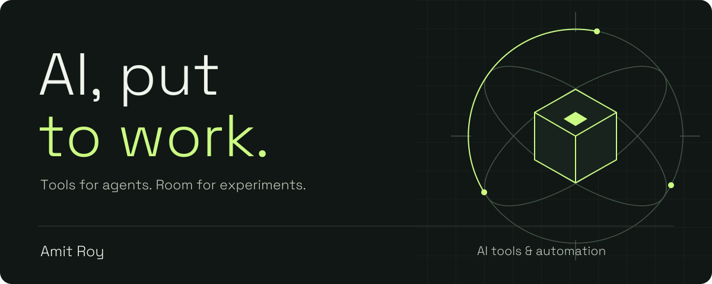

# Give the agents a workspace.

I'm nefro. I build the tools around AI: places to run agents, see what they're doing, and connect them to everyday development.

[Explore the code](https://github.com/nefr0?tab=repositories) · [Watch Agent Console](https://youtu.be/JNqju6qvxvc) · [Discuss an idea](https://github.com/nefr0/agent-console/issues)

## Agent Console

### Your agents. Your machine. Any screen.

A browser workspace for **Claude Code, Codex, and Pi**. Pick up a thread on your laptop or phone, inspect files, and keep the work in view.

- **Work across agents.** Separate threads, resumable sessions, and cross-agent forks.
- **Stay close to the code.** File viewing, diffs, inline media, and session search.
- **Keep work moving.** Scheduled tasks and workflows driven by GitHub issues.

[Browse the source](https://github.com/nefr0/agent-console) · [Watch the tour](https://youtu.be/JNqju6qvxvc)

See Agent Console in action

## More pieces of the toolkit

| Project | What it does |
| :--- | :--- |
| **[Claude Yoke](https://github.com/nefr0/claude-yoke)** | A terminal UI for Claude Code. Live token usage, an agents panel, and a session browser. |
| **[Harden VPS](https://github.com/nefr0/harden-vps)** | Debian server hardening in one command. Firewall, key-only SSH, and security monitoring. |

## The thread through it all

Useful AI needs more than a prompt. It needs an interface you can understand, workflows you can inspect, and infrastructure you can maintain.

That's the part I like building.

Have a workflow that keeps getting in your way? [Bring a concrete problem](https://github.com/nefr0/agent-console/issues).
